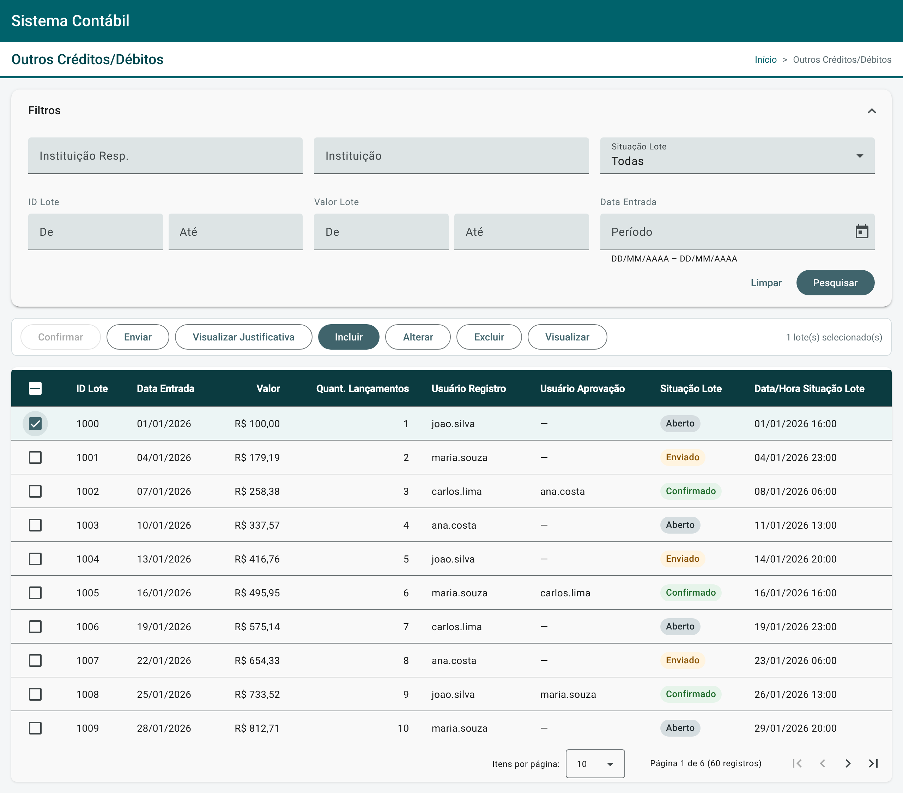
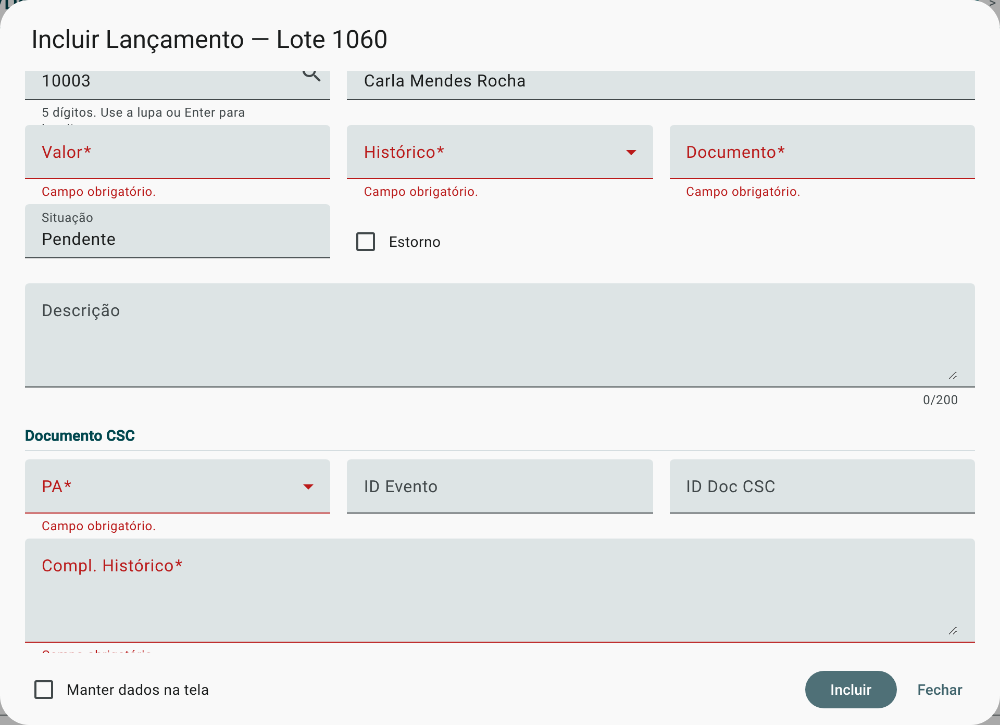
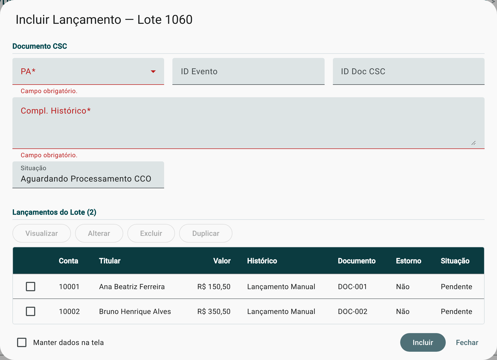

# Outros Créditos/Débitos — Angular

Modernização de duas telas do módulo contábil **Outros Créditos/Débitos**, migradas de Adobe Flex para Angular, como desafio técnico da Mirante Tecnologia.

- **Tela 1 — Consulta de Lotes:** filtros, pesquisa, ações sobre os lotes, tabela com seleção e paginação.
- **Tela 2 — Modal "Incluir Lançamento":** formulário com validações, busca de conta corrente e grade de lançamentos do lote.

Não há back-end: os dados são simulados em memória por serviços com Observables.



| Validações do modal | Lançamentos do lote |
|---|---|
|  |  |

## Como executar

**Pré-requisitos:** Node.js `^22.22.3`, `^24.15.0` ou `>=26` (exigência do Angular 22) e npm.

```bash
npm install
```

```bash
npm start
```

Acesse `http://localhost:4200/`.

| Comando | O que faz |
|---|---|
| `npm start` | Servidor de desenvolvimento (`ng serve`) |
| `npm test` | Testes unitários (Jest) |
| `npm run lint` | ESLint (angular-eslint) |
| `npm run build` | Build de produção |

## Tecnologias

| | Versão |
|---|---|
| Angular (standalone components, signals, control flow `@if`/`@for`/`@switch`) | 22.3 |
| Angular Material + CDK | 22.3 |
| RxJS | 7.8 |
| TypeScript | 6.0 |
| Jest + jest-preset-angular | 30 / 17 |

## Dados para testar

Os dados são gerados em memória ao abrir a aplicação e voltam ao estado inicial quando a página é recarregada.

- **60 lotes**, IDs de 1000 a 1059, nas situações Aberto, Enviado e Confirmado.
- **Contas correntes existentes:** `10001` a `10005`, `20001` e `20002`. Qualquer outro número mostra "Conta corrente não encontrada".
- **Erro simulado:** pesquise com **Instituição Resp. = `9999`** para ver o tratamento de erro e o botão "Tentar novamente".
- **Fluxo de situação:** Aberto → Enviado → Confirmado. "Enviar" exige lotes Abertos e "Confirmar" exige lotes Enviados.

## Estrutura

```
src/app/
  core/
    config/      latência simulada, instituição de erro, usuário atual
    mocks/       lotes, contas e opções dos selects
    models/      Batch, BatchEntry, BatchFilter, Range<T>, PageResult<T>...
    services/    BatchService, BatchEntryService, AccountService (API simulada)
    utils/       simulação de requisição e funções de filtro (puras)
  shared/
    components/  page-header, confirm-dialog
    directives/  campo monetário (ControlValueAccessor)
    forms/       mensagens de validação, ErrorStateMatcher de faixa
    i18n/        textos do paginador em pt-BR
    validators/  rangeValidator, positiveValueValidator
  features/other-credits-debits/
    pages/       batch-search (container: estado e chamadas aos serviços)
    components/  batch-filters, batch-actions, batch-table, entry-dialog, entry-table
    pipes/       rótulo da situação do lote
src/styles/      design tokens, tema do Material, breakpoints
src/testing/     providers e fábricas compartilhados pelos testes
```

## Decisões técnicas

### Componentização
- **Container/presentational.** A página `batch-search` guarda o estado e chama os serviços. Filtros, ações, tabelas e modal só recebem dados (`input()`) e emitem eventos (`output()`/`model()`), o que os torna reutilizáveis e fáceis de testar.
- **Standalone components com `OnPush`** e signal inputs. O `page-header` e o `confirm-dialog` ficam em `shared/` porque servem a qualquer tela migrada.

### Estado e assincronismo
- **Signals para estado, RxJS para eventos no tempo.** O estado da consulta é um signal `query` (filtro + página), que é a única entrada da pesquisa. Lista, total e página atual são `computed`.
- **Fluxo de pesquisa:** `toObservable(query)` → `debounceTime` → `switchMap` (cancela respostas antigas) → `catchError` **dentro** do `switchMap`, para um erro não encerrar o fluxo. `takeUntilDestroyed` evita vazamento de memória.
- **API simulada com `timer` + `map`** em vez de `of().pipe(delay())`: a requisição só roda no subscribe e os erros também chegam com latência, como numa API real. A latência é um `InjectionToken` (`API_LATENCY_MS`), configurado com 0 nos testes.
- **Paginação no "servidor":** o serviço devolve só a página pedida e o total.
- **Serviços imutáveis:** sempre devolvem cópias, então um componente não altera os dados armazenados por engano.

### Formulários reativos
- **Formulários tipados** que espelham os modelos: o `getRawValue()` dos filtros já é um `BatchFilter`. Campos que nunca ficam vazios (como a Situação "Todas") são `nonNullable`, para o `reset()` voltar ao valor inicial.
- **Faixas De/Até como `Range<T>`** e um único **validador de grupo** (`rangeValidator`) para ID, valor e data. Um `ErrorStateMatcher` destaca os dois campos quando a faixa é inválida.
- **Validador customizado `positiveValue`** para o valor do lançamento, além dos nativos (`required`, `pattern`, `maxLength`, `min`).
- **Mensagens de erro centralizadas** em um mapa (`validation-messages.ts`).
- **Campo monetário próprio** (`CurrencyInputDirective`, um `ControlValueAccessor`): mostra `R$ 1.500,50` e entrega um `number` ao formulário. `type="number"` não entende o formato brasileiro.
- **Conta corrente:** o titular é obrigatório e somente leitura, então o lançamento só é aceito depois que a conta é localizada pela lupa (ou Enter).
- **Modal com três modos** (incluir, alterar, visualizar) sobre um único formulário. Depois de incluir, `FormGroupDirective.resetForm()` limpa também o estado de envio, para os campos não ficarem vermelhos.

### Regras de negócio
- **Alterar/Excluir/Visualizar** só ficam habilitados com **exatamente um** lote selecionado.
- **Transições de situação** validadas na tela (botões) **e** no serviço (como faria o back-end).
- **Ações despachadas com `switch` exaustivo** e `assertNever`: uma ação nova sem tratamento não compila.
- **Exclusões pedem confirmação**, com o foco inicial em "Cancelar".
- **Seleção limpa a cada nova pesquisa ou página**, para nenhuma ação atingir lotes fora da tela.

### Visual e acessibilidade
- **Design tokens** em variáveis CSS (`src/styles/_token.scss`). O tema do Material é gerado a partir da mesma cor verde-petróleo e ajustado só pelas APIs oficiais de override, sem `::ng-deep`.
- **Responsivo** com CSS Grid (filtros em 3, 2 ou 1 coluna) e tabelas com rolagem horizontal no celular.
- **Acessibilidade:** labels em todos os campos, `fieldset`/`legend` nas faixas, `aria-label` em botões de ícone e checkboxes, `aria-live` nos contadores, `role="alert"` nos erros, skip link, navegação por teclado e Esc nos modais.
- **pt-BR:** `LOCALE_ID`, pipes de moeda e data, datepicker e paginador ("Página 1 de 6").

## Interpretações e simplificações

- **Documento CSC:** o enunciado permite simplificar os campos além do PA. O **ID Evento** é um campo numérico simples. A **Pesquisa de Evento** (modal com busca, tabela e paginação) ficou fora e seguiria o mesmo padrão da busca de conta corrente.
- **Anexos:** aparecem nas telas de referência, mas não no enunciado escrito. Ficaram fora do escopo.
- **Grade de lançamentos:** exibida dentro do modal, com Visualizar, Alterar, Excluir e Duplicar, como pede o texto do enunciado. Ao fechar o modal, a consulta é atualizada com o valor e a quantidade de lançamentos do lote.
- **Incluir** cria um lote Aberto e abre o modal. Se o modal for fechado sem lançamentos, o lote vazio é removido.
- **Alterar** só abre lotes Abertos. Os lotes do mock não têm lançamentos detalhados, por isso a grade deles abre vazia.
- **Visualizar e Visualizar Justificativa** (dos lotes) mostram um aviso de "fora do escopo".

## Testes

74 testes unitários com Jest (`npm test`):

- **Validadores** e **funções de filtro**, incluindo os casos de borda (zero como limite, último dia da faixa de datas).
- **`BatchService`** (paginação, filtro, erro simulado, transições de situação, totais) e **`BatchEntryService`**.
- **Componentes:** regras dos botões da barra de ações, filtros (com um teste de regressão do "Limpar"), tabelas, modal (busca de conta, validações, inclusão, "Manter dados na tela") e a diretiva monetária.

## Limitações conhecidas

- **Datas digitadas:** o `NativeDateAdapter` funciona pelo calendário, mas não interpreta datas digitadas no formato `dd/MM/aaaa`. A solução seria o `@angular/material-date-fns-adapter` com o locale `ptBR`.
- **Campo monetário:** como o valor é reformatado a cada tecla, o cursor fica sempre no final.
- **Budget de build:** o bundle inicial passa do orçamento padrão de 500 kB por causa do Angular Material. Sem impacto no desafio.

## Processo

- Uma branch por funcionalidade (paginação, ações, modal, testes) integrada por Pull Request, com commits no padrão Conventional Commits (`feat`, `fix`, `style`, `test`, `chore`).
- **Uso de IA:** <!-- AJUSTE ESTE TRECHO PARA REFLETIR EXATAMENTE COMO VOCÊ USOU --> usei o Claude como apoio para planejamento, revisão de código, geração de dados mock, estilos e testes unitários. A arquitetura, as decisões e a revisão de todo o código são minhas.
